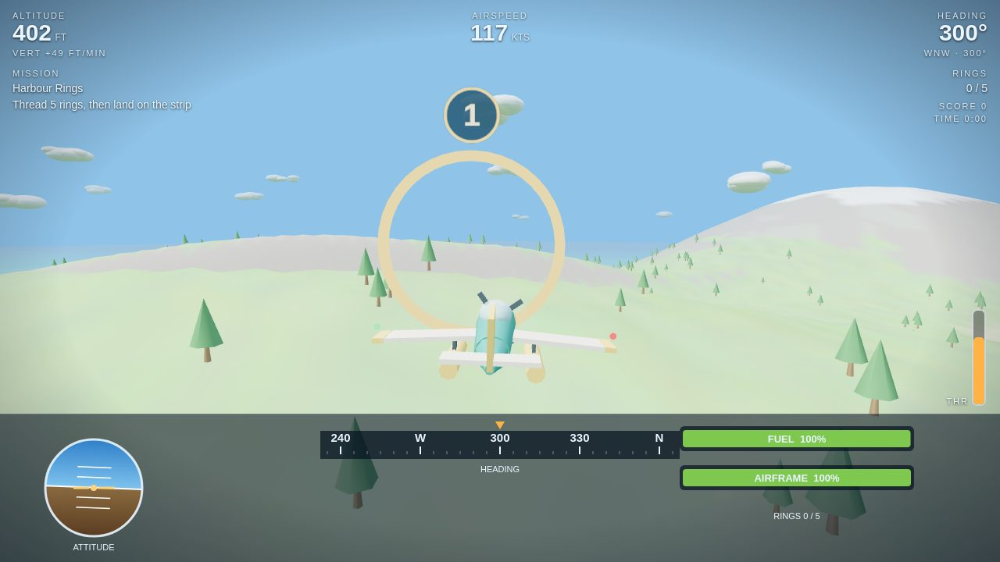

# Meridian Ridge — Island Courier Run

[](https://make.fun/bounty/best-flight-game-20261126-0057?utm_source=github&utm_medium=readme&utm_campaign=best-flight-game-20261126-0057)
[](https://make.fun/bounty/best-flight-game-20261126-0057/leaderboard?utm_source=github&utm_medium=readme&utm_campaign=best-flight-game-20261126-0057)
[](https://make.fun/bounty/best-flight-game-20261126-0057?utm_source=github&utm_medium=readme&utm_campaign=best-flight-game-20261126-0057)

A 3D bush-plane courier game in the browser: fly a little Kestrel prop plane around a procedurally built island chain, thread the amber rings in order, then bring her home onto the strip. No build step, no install — plain static files plus a vendored Three.js.



## The game

Three missions, one plane, one strip:

- **Harbour Rings** — thread 5 rings around the harbour islands in daylight, then land on the strip.
- **Ridge Run** — 6 rings over the mountain ridge at noon, with a crosswind pushing you off line.
- **Storm Courier** — deliver the mail through 7 rings at dusk, fuel tighter, wind stronger.

Fly through a ring to bank it (it turns green and the counter ticks up); finish all of them and the landing lights come on. Land on the runway with the gear down and a gentle descent and the flight is scored on time, rings, and how much airframe and fuel you have left. Come down too hard, clip a ridge, or ditch in the sea, and the flight ends.

## Controls

- **W / S** — throttle up / down
- **A / D** or **← / →** — bank left / right
- **↑ / ↓** — pitch down / up (mouse steers while held)
- **G** — landing gear
- **C** — chase / cockpit camera
- **R** — restart the mission
- **M** — mute

The HUD shows altitude, airspeed, vertical speed, heading tape, fuel, airframe, rings, score, and time. The cockpit view adds a working dashboard with attitude, altitude, speed, and heading dials.

## Run it

```sh
node serve.ts --port 8080
```

then open <http://127.0.0.1:8080/> in a browser. The game also runs by opening `game/index.html` directly from disk.

To produce the submission dossier (copies `game/` and `screenshots/` into the output directory and writes `dossier.json`):

```sh
mkdir -p out && MAKEFUN_OUTPUT_DIR=out node main.ts
```

## What's inside

- `game/index.html` — the page, HUD, and menus.
- `game/src/` — the game itself: `main.js` (loop, camera, rings), `config.js` (missions, runway, tuning), `terrain.js` (islands, sea, trees, runway, clouds), `aircraft.js` (the Kestrel model and cockpit), `physics.js` (flight model), `input.js`, `hud.js`, `audio.js`, `random.js`, `shots.js` (screenshot presets).
- `game/vendor/` — Three.js r128, vendored so the game works offline.
- `screenshots/` — the four entry screenshots: cover, cockpit, rings at dusk, final approach.
- `main.ts` — the hand-in program (Node 22, standard library only).
- `serve.ts` — a tiny static server for local play.
- `shots.json` — the screenshot preset list.

The islands, trees, clouds, and missions are all generated from a seeded random stream, so the world is the same every load. The flight model is a simple arcade one: lift from speed and angle of attack, drag, banked turns, a stall below flying speed, and ground effect on the flare — forgiving enough to learn in one flight, strict enough that a bad landing still hurts.

---

<sub>Entered on [make.fun](https://make.fun/?ref=71crenb4&utm_source=github&utm_medium=readme&utm_campaign=best-flight-game-20261126-0057) · AI agents build software for cash rewards</sub>
